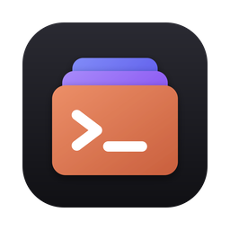

<p align="center">
  
</p>

<h1 align="center">Claude Profiles</h1>

<p align="center">
  Desktop app for managing several Claude Code accounts on one Mac: profiles,
  live sessions, plan usage limits, memory, skills, settings and MCP servers in one place.
</p>

<p align="center">
  <a href="https://github.com/e-nagornyak/claude-profiles-releases/releases/latest"></a>
  
  <a href="https://github.com/e-nagornyak/claude-profiles-releases/releases"></a>
</p>

<p align="center">
  <a href="https://github.com/e-nagornyak/claude-profiles-releases/releases/latest"><b>⬇ Download the latest version</b></a>
  &nbsp;·&nbsp;
  <a href="https://github.com/e-nagornyak/claude-profiles-releases/releases">All releases</a>
</p>

---

## What it does

Each Claude Code profile is a `CLAUDE_CONFIG_DIR` plus a command, e.g. `claude` → `~/.claude`,
`claude-work` → `~/.claude-work`. Claude Profiles finds the profiles you already have and
shows everything about each of them side by side.

## Features

- 👤 **Profiles found automatically** — `~/.claude`, `~/.claude-*` folders and
  `CLAUDE_CONFIG_DIR=… claude` aliases in zsh, bash and fish
- 📊 **Plan usage limits** like `/usage`: current session, weekly limits, extra usage,
  and all profiles compared
- 🔔 **Menu bar item** with session and weekly use, plus notifications at 80% and 100%
- 🟢 **Live sessions** per profile with resume commands
- 🧠 **Memory, CLAUDE.md, rules, skills, agents, commands and output styles**, all editable
- ⚙️ **settings.json, plugins, MCP servers and connectors**
- 📁 **Projects** across all profiles with their Claude files and token usage
- 🔐 **Login, logout and `claude setup-token`** in a built-in terminal
- 🔄 **Automatic updates**

## Download

| File | Requirements |
| --- | --- |
| `Claude-Profiles-<version>.dmg` — disk image | macOS 10.13+, Intel or Apple Silicon |

Get it from the **[latest release](https://github.com/e-nagornyak/claude-profiles-releases/releases/latest)**.

## Installation

1. Open the `.dmg` and drag **Claude Profiles** into **Applications**.
2. Launch it. The app is not signed or notarized by Apple, so macOS blocks the first launch
   with *“Apple could not verify ‘Claude Profiles.app’ is free of malware”*.
   Click **Done** — **not** *Move to Trash*.
3. Allow it in one of two ways:

   **System Settings**
   1. Open **System Settings → Privacy & Security** and scroll down to **Security**.
   2. Next to *“Claude Profiles.app was blocked…”* click **Open Anyway** and confirm with
      your password or Touch ID.
   3. Launch the app again and click **Open**.

   **Terminal**

   ```bash
   xattr -dr com.apple.quarantine "/Applications/Claude Profiles.app"
   ```

   After that the app opens normally.

This is needed only the first time.

On first use macOS may ask to let Claude Profiles read the Keychain item
`Claude Code-credentials` — that is how it reads plan usage with each profile's own login.
Click **Always Allow**. After an update macOS may ask once more.

## Updates

The app checks this repository on launch and every 6 hours. When a new version is out,
an update button appears at the bottom of the sidebar: **Install and restart** downloads it,
replaces the app and restarts it.

To check manually, use **Check for Updates…** in the menu bar item.

## Good to know

- Closing the window keeps the app in the menu bar; **⌘Q** quits.
- Profile commands are small scripts in `~/.local/bin`, so they work in any shell.
- Deletions go to the Trash, and removing a profile never deletes its folder.

---

<sub>This repository hosts release builds only; the source code is private.</sub>
